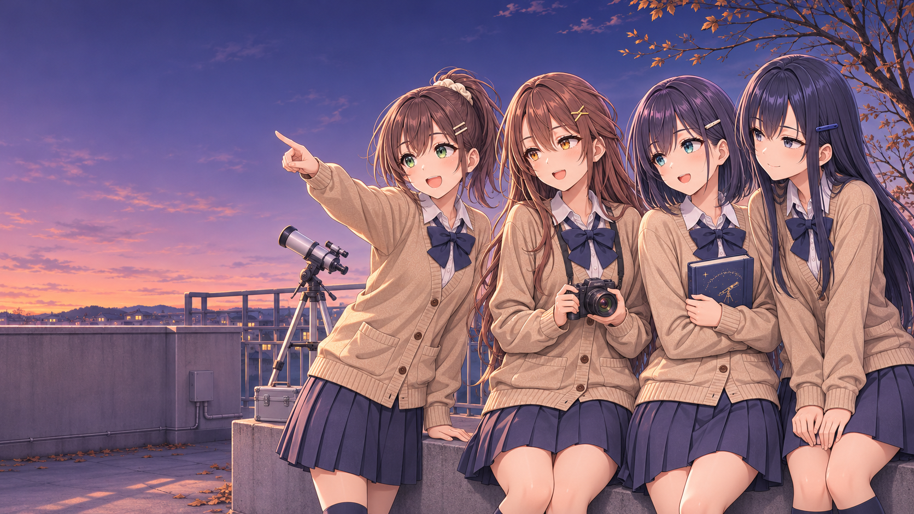
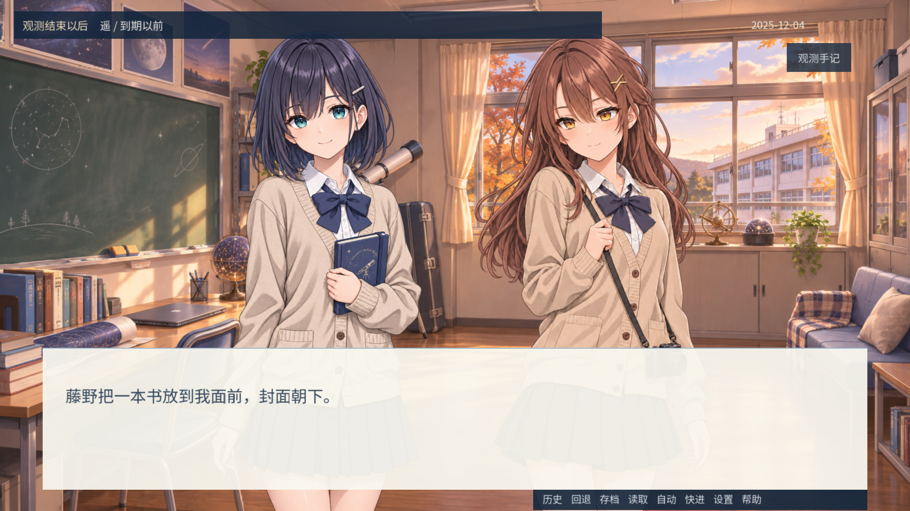
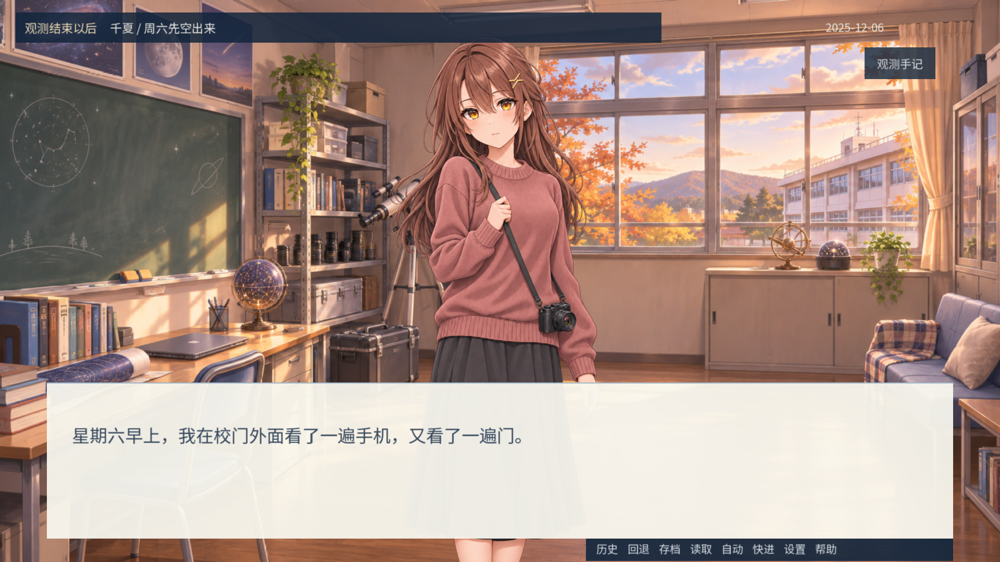
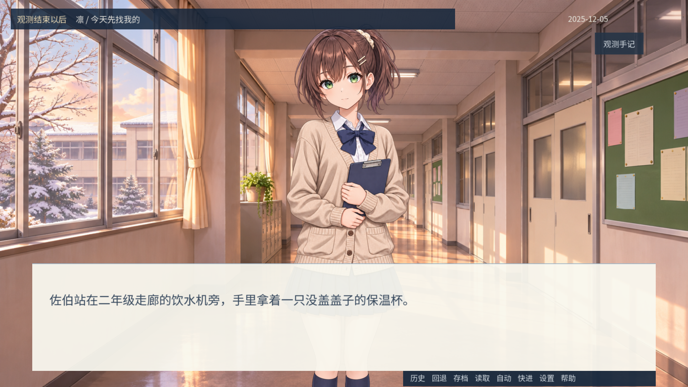
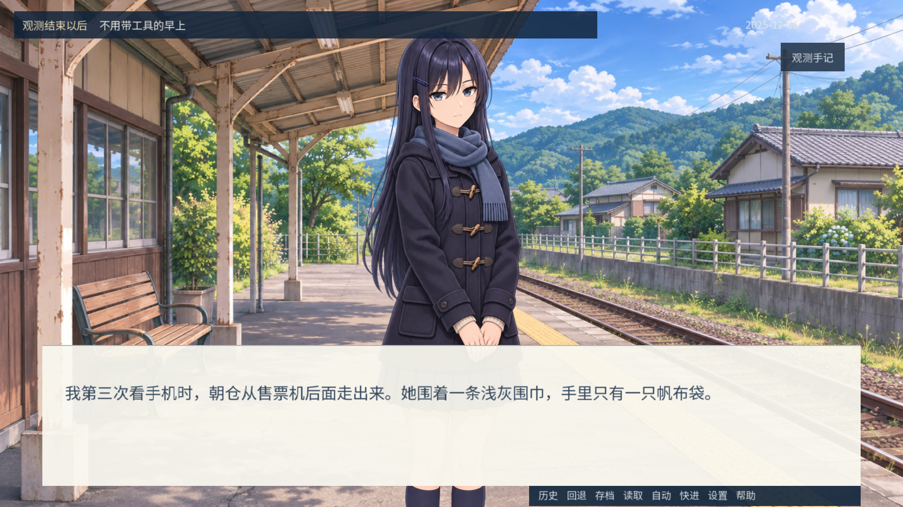

# 观测结束以后

高桥悠介只是来送一张观测会海报。

第一次凑近目镜，他才发现，刚才以为只有一颗的地方，原来有两颗星。于是下周，他又来了一次。

从秋天到春天，和天文社的四位女生一起筹备公开观测。等云、借书、去邻市看展，原本只是顺路的见面，渐渐有了别的理由。

到了十九点半，镜筒装回箱子。回去的路，还想多走一会儿。

## 和谁一起看星星

**藤野遥**喜欢小说，也喜欢安静地看完一个目标。她会记得你上次没看清哪里，也会等你主动约下一次。

**小原千夏**总带着相机，喜欢拍车站、店门和回家的路。她偶尔也想放下相机，让你先看她。

**佐伯凛**是天文社的一年级成员，认星很认真，玩游戏也不肯轻易认输。轮到自己带别人看时，才发现知道和讲清楚是两回事。

**朝仓灯里**喜欢做小东西，话不多，吐槽常常来得很准。她的包里有零件，也有一本不会拿去展示的唱片目录。

## 游戏画面

| 藤野遥 · 到期以前 | 小原千夏 · 周六先空出来 |
| :---: | :---: |
|  |  |
| **佐伯凛 · 今天先找我的** | **朝仓灯里 · 不用带工具的早上** |
|  |  |

## 下载

[Windows / Linux 版本与离线全文](https://github.com/YuanzeSun/after-observing/releases)

itch.io 页面准备中。
